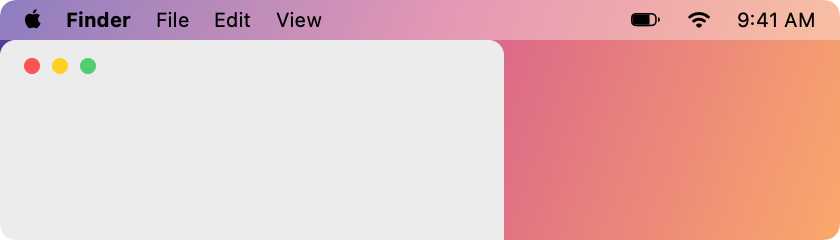
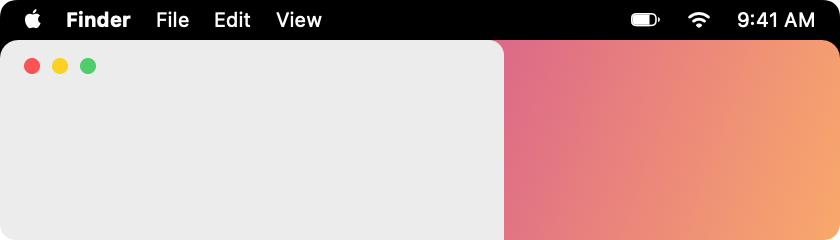
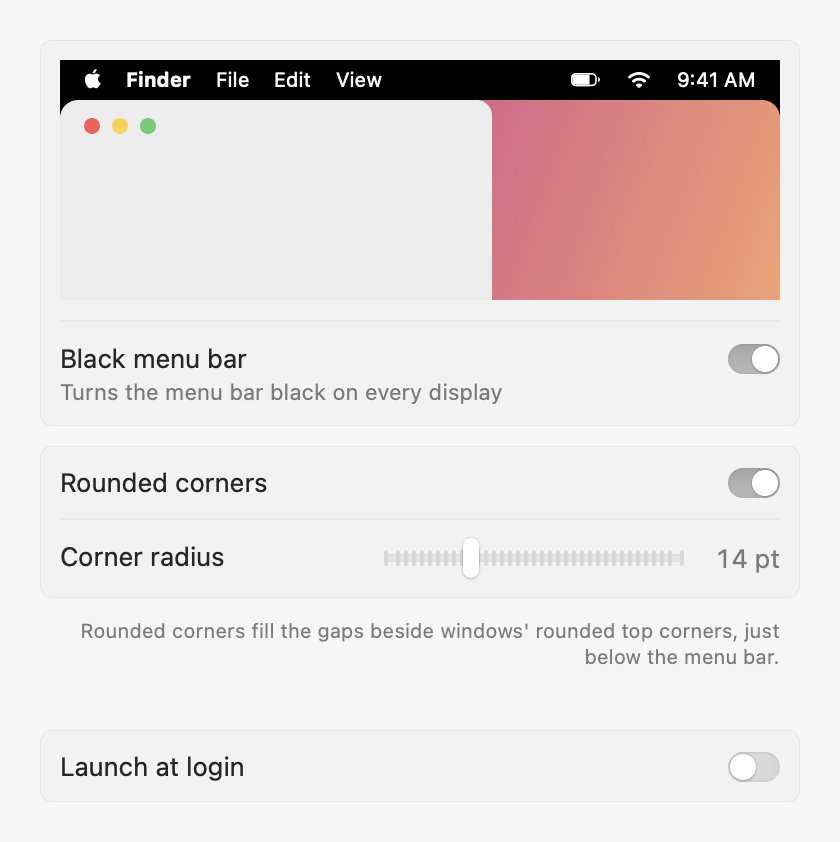

# Blackbar

A tiny macOS menu bar app that makes your menu bar solid black, with optional
rounded corners beneath it.

Use it to hide the notch on newer MacBooks, or because a black bar looks
cleaner on any Mac.

| Before | After |
| --- | --- |
|  |  |

## Quick start

Requires macOS 14 or later.

### Download

1. Download
   [**Blackbar.dmg**](https://github.com/johnjp15/blackbar/releases/latest/download/Blackbar.dmg)
   from the [latest release](https://github.com/johnjp15/blackbar/releases/latest)
   and open it.
2. Drag **Blackbar** onto the **Applications** folder, then open it from
   Applications.
3. macOS will block it the first time, with a message like *"Apple could not
   verify Blackbar is free of malware."* This is expected: Blackbar isn't
   notarized by Apple (that requires a paid developer account). To open it:
   1. Click **Done** in the warning.
   2. Open **System Settings → Privacy & Security** and scroll down to
      **Security**.
   3. Next to *"Blackbar was blocked to protect your Mac"*, click
      **Open Anyway**, then confirm with your password or Touch ID.

   You only need to do this once. If you prefer Terminal, this does the same:

   ```sh
   xattr -dr com.apple.quarantine /Applications/Blackbar.app
   ```

Your menu bar turns black right away. Look for the Blackbar icon in the menu
bar to change settings.

### Build from source

Needs the Xcode Command Line Tools (full Xcode isn't needed). Apps you build
yourself aren't blocked, so no **Open Anyway** step is required:

```sh
xcode-select --install   # if you don't have the Command Line Tools yet
git clone https://github.com/johnjp15/blackbar.git
cd blackbar
./scripts/build-app.sh
open build/Blackbar.app
```

To keep the app, drag `build/Blackbar.app` into `/Applications`.

## Features

- **Black menu bar** with white text, on every display.
- **Rounded corners**: black curved corners below each end of the bar, with
  an adjustable radius. They fill the gaps where the wallpaper peeks out
  beside windows' rounded top corners.
- **Follows your wallpaper**: pick a new wallpaper and Blackbar re-blackens it
  within a few seconds.
- **Multiple displays and Spaces**: each display gets an image sized to fit
  it, and each Space gets its edited wallpaper when you switch to it.
- **Fully reversible**: turning it off restores your original wallpaper.
  Blackbar never modifies your image files.
- **No special permissions** needed.

## How it works

The macOS menu bar is translucent, and what shows through it is the desktop
wallpaper. Blackbar doesn't draw over the menu bar. Instead it:

1. Reads each screen's current wallpaper.
2. Renders a copy at the screen's exact pixel size, with a black strip as tall
   as the menu bar (plus the corner pieces, if enabled).
3. Sets that copy as the wallpaper.

macOS then draws the menu bar black and switches its text to white
automatically. Generated images are stored in
`~/Library/Application Support/Blackbar/Wallpapers`.

Because the effect lives in your wallpaper, the menu bar **stays black after
you quit Blackbar**, even across restarts. Keep the app running (or enable
**Launch at Login**) if you want it to handle new wallpapers, displays, or
Spaces automatically.

## Settings

<picture>
  <source media="(prefers-color-scheme: dark)" srcset="docs/settings-dark.png">
  
</picture>

The settings window shows a live preview of the current settings. Open it from
the menu bar icon (**Settings…**) or by opening the app again while it's
running.

## Usage

Click the menu bar icon to open the menu:

| Item | What it does |
| --- | --- |
| **Black Menu Bar** (⌘B) | Turn the effect on or off |
| **Rounded Corners** | Toggle the corner pieces below the bar |
| **Settings…** (⌘,) | Open the settings window |
| **Refresh Wallpaper** (⌘R) | Re-apply to all screens now |
| **Quit Blackbar** (⌘Q) | Quit (the black bar stays) |

The settings window adds the corner radius slider and **Launch at Login**.

## Limitations

- **Still images only.** Dynamic and Aerial wallpapers can't be read as a
  single image. Blackbar shows a message if you're using one.
- **Reduce transparency** (System Settings → Accessibility → Display) makes the
  menu bar opaque, so the wallpaper doesn't show through and Blackbar has no
  visible effect.
- If you change display scaling, click **Refresh Wallpaper** (or keep Blackbar
  running) so the strip matches the new menu bar height.

## Uninstall

1. Turn off **Black Menu Bar** to restore your original wallpaper.
2. Quit Blackbar and delete the app.
3. Remove `~/Library/Application Support/Blackbar`.

## Development

```sh
swift build          # compile
swift run            # run without bundling (Launch at Login won't work)
./scripts/build-app.sh   # build and ad-hoc sign build/Blackbar.app
./scripts/make-dmg.sh    # package build/Blackbar.dmg for releases
./build/Blackbar.app/Contents/MacOS/Blackbar --snapshot docs   # regenerate README images
```

| File | Purpose |
| --- | --- |
| `Sources/Blackbar/WallpaperManager.swift` | Rendering, applying, and restoring wallpapers |
| `Sources/Blackbar/BlackbarApp.swift` | App entry point and menu bar menu |
| `Sources/Blackbar/SettingsView.swift` | Settings window (SwiftUI) |
| `scripts/build-app.sh` | Builds the `.app` bundle with `Info.plist` and signing |
| `scripts/make-dmg.sh` | Packages the app into a drag-to-install disk image |
